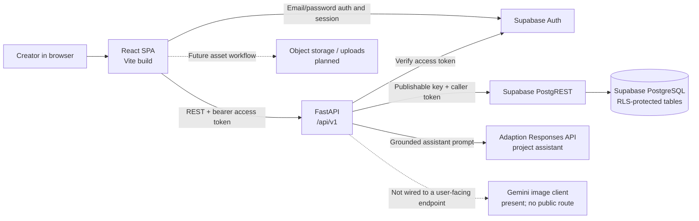
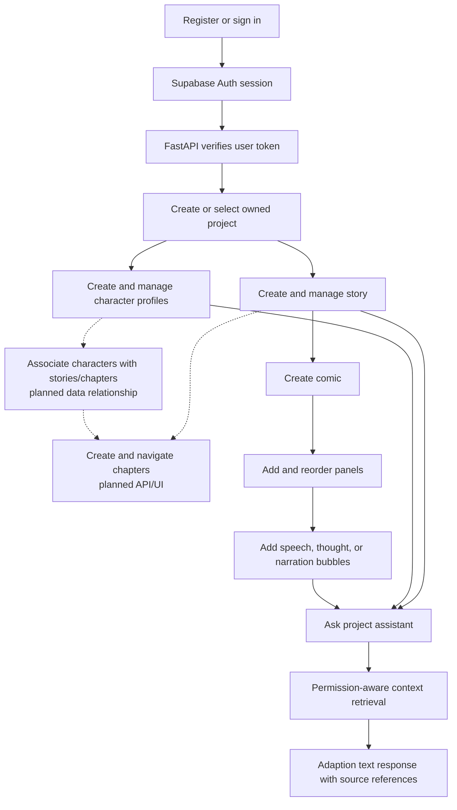

# Weavecom.ai

Weavecom.ai is a creative workspace that helps writers shape stories and characters into comics, with project-aware AI assistance.

> **Implementation status:** This repository contains a functional foundation and several persisted MVP workflows. The product vision and Phase 2 items below are roadmap descriptions, not claims that those capabilities are already complete. “Phase 1 — 50%” and “Phase 2 — remaining 50%” describe the product plan, not a measured completion percentage.

## Table of Contents

1. [🚀 Project Briefing](#-project-briefing)
2. [📌 Problem Statement](#-problem-statement)
3. [💡 Project Overview](#-project-overview)
4. [🎯 Project Objectives](#-project-objectives)
5. [✨ Key Features](#-key-features)
6. [🛠️ Two-Phase Development Roadmap](#️-two-phase-development-roadmap)
7. [🏗️ System Architecture](#️-system-architecture)
8. [🔄 Application Workflow](#-application-workflow)
9. [🧠 AI Architecture and Functionality](#-ai-architecture-and-functionality)
10. [💻 Technology Stack](#-technology-stack)
11. [🗄️ Database Design](#️-database-design)
12. [👥 User Roles and Platform Modules](#-user-roles-and-platform-modules)
13. [📂 Project Folder Structure](#-project-folder-structure)
14. [⚙️ Installation and Setup](#️-installation-and-setup)
15. [🔐 Environment Variables](#-environment-variables)
16. [▶️ Running the Project](#️-running-the-project)
17. [📈 Future Scope](#-future-scope)
18. [🎯 Expected Outcome](#-expected-outcome)

## 1. 🚀 Project Briefing

Weavecom.ai brings story development, character management, comic composition, and project-aware AI assistance into one creative platform.

## 2. 📌 Problem Statement

> Storywriters and comic editors often face collaboration gaps when transforming written stories into visually engaging comics. Understanding complex plots, breaking stories into scenes, maintaining character consistency, and finding the right creative collaborators can be time-consuming and inefficient.
>
> Weavecom.ai solves this by providing an AI-powered platform that simplifies story analysis, enables collaborative comic creation, and connects writers and comic editors through an integrated freelance marketplace.

This is the product problem the platform aims to address. Collaboration and marketplace capabilities are part of the roadmap; they are not currently implemented as complete services in this repository.

## 3. 💡 Project Overview

Weavecom.ai is envisioned as a workspace for developing stories into comics. Writers can organize projects, stories, and character information; comic editors can turn story material into panels and dialogue; and AI assistance can help users query the saved content.

The platform is needed because story planning, character continuity, comic layout, and collaboration are often split across separate tools. A connected workspace can reduce repeated context gathering and give writers and editors a shared foundation for production.

In the current implementation, authenticated users can create and persist projects, stories, characters, comics, panels, and speech bubbles. A project assistant can answer questions using relevant saved stories, character profiles, and completed comic content. The architecture uses Supabase for authentication and project data access and a FastAPI service for application APIs.

The broader product vision includes live writer-editor collaboration, richer story analysis, publishing, and a freelance marketplace. These remain planned modules until their corresponding application logic, data models, and interfaces are implemented.

## 4. 🎯 Project Objectives

- Give creators a structured place to manage projects, stories, and character profiles.
- Preserve ownership boundaries when users read and update saved work.
- Support a persisted path from a story to comic panels and dialogue.
- Make AI assistance grounded in the content of an accessible project rather than generic prompts alone.
- Keep the foundation modular so collaboration, publishing, and creator services can be added without claiming they already exist.
- Protect creator work through authenticated access and database row-level security (RLS).

## 5. ✨ Key Features

### Phase 1 — Functional MVP (50%)

The “50%” designation is the product plan’s scope split. It is not a test result or a claim that half of all planned functionality has been delivered.

#### A. Character Creation Studio

**Implemented:** Authenticated create, list, update, and delete APIs persist characters under a project. Profiles include a name, description, personality, appearance, background, character role, traits/abilities from the base schema, and an optional image URL. The Character Studio route is present in the frontend.

**Not yet implemented:** Character draft lifecycle, image upload/storage, automated chapter-wise appearance tracking, and explicit story/chapter-to-character associations. Characters currently belong to projects.

#### B. Story Studio

**Implemented:** Authenticated story create, list, update, and delete APIs persist project-linked stories. Story metadata includes title, description, genre, synopsis, main plot, draft/published status, and ordering. The Story Studio route is present.

**Partially present:** A `chapters` table supports ordered chapter titles and body text with cascading deletion from a story. There are no chapter CRUD API routes in the current backend, so chapter creation, editing, navigation, and progress tracking are not end-to-end implemented.

#### C. AI Story Intelligence

**Implemented:** The project assistant accepts a project and question, retrieves a bounded set of relevant saved story, character, and completed comic/panel/dialogue records, and asks the configured Adaption text provider to answer from that context. Answers include source references. If retrieval finds no relevant records, the API returns an explicit insufficient-context response without calling the provider.

**Not yet implemented:** Persistent AI conversation history, chapter-aware retrieval, generated story summaries, character relationship graph reasoning, dedicated dialogue rewriting, and AI-to-comic conversion workflows. An internal writing-suggestion service exists, but it is not exposed as a public API route in the current app.

#### Additional persisted MVP capability: Comic editor foundation

Authenticated APIs and database tables support comic records, ordered panels, layout JSON, optional external image URLs, and speech/thought/narration bubbles with positions. Panels and bubbles can be created, updated, deleted, and reordered. This is a functional editing foundation, not a complete production comic editor: image upload, generated artwork, export/publishing, and advanced panel-generation workflows are absent.

### Phase 2 — Advanced Platform (Remaining 50%)

All modules in this section are proposed product capabilities unless explicitly marked as implemented in the Phase 1 descriptions above.

#### A. Advanced Comic Editor — planned

Expand panel editing into a production editor with visual page composition, reusable layouts, asset management, scene-to-panel assistance, and export-ready comic pages. AI-assisted panel or image generation is not currently connected to an end-user route.

#### B. Advanced AI Story Intelligence — planned

Add chapter-aware context, summaries, continuity checks, plot-hole detection, character relationship reasoning, scene breakdowns, and revision suggestions. Retrieval should include permissions-aware source links and remain grounded in the user’s accessible story material.

#### C. Real-Time Collaboration — planned

Allow writers and editors to co-edit selected projects, coordinate changes, comment on work, and see updates in real time. The repository currently has no collaboration service, shared editing protocol, or collaboration tables.

#### D. Freelance Marketplace — planned

Enable creators to publish service listings or project briefs, discover comic editors and other freelancers, review applications, and manage engagements. A Marketplace frontend route and service abstraction exist, but there are no corresponding marketplace backend routes or database entities yet.

#### E. Advanced User Management — planned

Introduce explicit role and permission administration, invitations, team membership, and project-level access grants. The current platform authenticates Supabase users and uses ownership/published-content policies; it does not provide an admin console or user-managed role assignment.

#### F. Publishing and Distribution — planned

Support publication workflows, public comic pages, reader discovery, sharing, and distribution controls. Current `published` project/story and `completed` comic statuses provide data-level foundations, but a complete publishing and distribution experience is not implemented.

## 6. 🛠️ Two-Phase Development Roadmap

| Area | Phase 1 — Functional MVP foundation | Phase 2 — Advanced platform |
|---|---|---|
| Character Management | Project-scoped character profiles and persisted CRUD | Advanced visual character management, references, and chapter continuity |
| Story Management | Persisted story metadata and draft/published status; chapter table foundation | Chapter workflows, navigation, progress, and advanced storytelling workflows |
| AI | Project-aware Q&A with bounded retrieval and source references | Plot-hole detection, summaries, continuity intelligence, and chapter-aware assistance |
| Comic Creation | Persisted comics, ordered panels, layouts, and speech bubbles | Complete visual editor, asset workflows, panel generation, and publishing output |
| Collaboration | Individual project ownership | Real-time writer-editor collaboration, comments, and shared workspaces |
| Marketplace | Not included in MVP backend | Freelance listings, discovery, applications, and engagement workflows |
| Publishing | Basic project/story/comic status fields only | Public comic publishing, reader discovery, and distribution |

Phase 1 establishes the ownership model, core content relationships, authenticated APIs, and saved creative material that Phase 2 can build on. It also exposes implementation gaps—such as the missing chapter API and collaboration model—that should be addressed before representing the full product vision as available functionality.

## 7. 🏗️ System Architecture

### Current architecture

- **Frontend:** A React single-page application built with Vite. React Router provides landing, authentication, dashboard, story, character, comic, assistant, community, marketplace, and universe routes. Some routes have only frontend/demo foundations and are not backed by dedicated backend APIs.
- **Backend:** A FastAPI application exposes versioned routes under `/api/v1`, with Pydantic request/response schemas, authentication dependencies, error handling, and CORS configuration.
- **API communication:** The frontend API client sends JSON requests and bearer access tokens to the FastAPI service. The browser also uses Supabase Auth directly for email/password signup, sign-in, session restoration, and sign-out.
- **Authentication and database access:** FastAPI verifies Supabase access tokens. Content queries use a Supabase publishable key together with the caller’s token so PostgreSQL RLS applies to that user. The server secret-key client is reserved for Auth token verification.
- **AI:** The assistant API uses the Adaption Responses API for project-grounded text answers. A Gemini image-generation client is present in the backend but is not exposed through a user-facing API route.
- **Files and images:** The database stores optional image URLs for characters and comic panels. No upload endpoint or configured object-storage workflow is present; URLs must refer to externally managed assets.
- **Hosting:** No hosting provider or deployment pipeline is configured in the inspected repository.



The diagram’s dashed connections are explicit roadmap or unwired components, not active production flows.

## 8. 🔄 Application Workflow

### Current end-to-end paths

1. A user signs up or signs in with Supabase Auth from the frontend.
2. The frontend restores the session and requests the verified profile from FastAPI.
3. The user creates a project; the backend assigns ownership from the verified user ID.
4. The user creates and edits project-linked stories and character profiles.
5. The user creates a comic for a story, then adds/reorders panels and manages dialogue bubbles.
6. The user asks the project assistant a question. The backend checks project access, retrieves relevant saved stories, characters, and completed comic content, and returns an answer with source references when available.

Chapter work is not currently end-to-end: the database has a chapter table, but the backend has no chapter endpoints. Explicit character-to-story/chapter links are also absent. The diagram marks those planned workflow steps as dashed.



## 9. 🧠 AI Architecture and Functionality

### Implemented

- **Text provider:** The project assistant calls the Adaption Responses API through a backend client. The configured default model is `deepseek-v4-flash`; both the model and provider base URL are configurable.
- **Prompt construction:** The API checks project access, retrieves saved project records, then places those records and the user’s question into a bounded prompt. Instructions tell the provider to answer only from supplied records, treat records as untrusted reference data, avoid unsupported facts, and avoid discussing other projects.
- **Context retrieval:** Current retrieval uses keyword overlap—not embeddings or vector search—to rank a bounded set of stories, characters, and completed comics. Comic context can include panel descriptions and bubble text. It is limited to a small number of records and a bounded context length.
- **Permission handling:** The backend determines whether the caller owns the project. Non-owners are restricted to published content, while database RLS remains authoritative. Caller-token-scoped PostgREST requests preserve user-level access boundaries.
- **Conversation handling:** The assistant endpoint answers one question per request. There is no persisted AI conversation or message table, and no server-side chat-history feature.
- **Image provider foundation:** A Gemini image-generation client can call the configured Gemini image model and validate returned image data. It is not connected to an API endpoint or image storage workflow, so it is not currently an end-user image-generation feature.

### Planned AI capabilities

Chapter-aware context, summaries, character relationship intelligence, dialogue rewrites, plot-hole detection, continuity checks, scene-to-panel suggestions, generated comic imagery, and persistent conversational memory are future capabilities. A writing-assistance service/schema exists in the backend, but it is not currently exposed as a public route. The repository does not implement vector embeddings or a vector database.

## 10. 💻 Technology Stack

| Category | Technology found in the repository | Usage and status |
|---|---|---|
| Frontend | React 18, React Router, Vite, JavaScript/JSX, CSS | Implemented single-page application and production build |
| Backend | Python 3.11+, FastAPI, Pydantic, pydantic-settings, Uvicorn | Implemented API service and configuration |
| Programming languages | JavaScript, Python, SQL, HTML, CSS | Frontend, backend, migrations, and page shell |
| Database | Supabase PostgreSQL | Persisted schema and SQL migrations; RLS policies are part of the migrations |
| Authentication | Supabase Auth and Supabase Python SDK | Browser signup/sign-in; backend access-token verification |
| AI / LLM | Adaption Responses API; Google Gemini SDK | Adaption powers project assistant; Gemini image client exists but is not routed to the UI |
| API communication | JSON REST, HTTP bearer tokens, Supabase PostgREST | Frontend-to-FastAPI and backend caller-scoped data access |
| File storage | None integrated | Character/panel image URLs are supported; uploads and managed object storage are not implemented |
| Hosting and deployment | Not configured in repository | No verified hosting provider, deployment manifest, or CI deployment workflow |
| Development and testing | npm, Vite, Vitest, Testing Library, pytest, httpx | Frontend scripts and backend test suite are present |
| Canvas/editor library | Konva | Dependency available for canvas-based editing functionality |

## 11. 🗄️ Database Design

The current SQL migrations define the following Supabase/PostgreSQL entities. `ON DELETE CASCADE` relationships remove dependent content when a parent is deleted where specified.

| Entity | Current purpose and relationships |
|---|---|
| `auth.users` | Supabase-managed user identities; referenced by profiles and project ownership |
| `profiles` | Optional display name, avatar URL, and bio; primary key references `auth.users.id` |
| `projects` | Creator-owned workspace with title, description, genre, draft/published status, and page targets |
| `stories` | Belongs to a project; includes title, genre, ordering, description, synopsis, main plot, and draft/published status |
| `chapters` | Belongs to a story; stores ordered title/body content. The table exists, but chapter API/UI workflows are not currently implemented |
| `characters` | Belongs to a project; stores name, role information, traits/abilities, character details, and optional image URL |
| `comics` | Belongs to a story; stores title, description, and draft/completed status |
| `comic_panels` | Belongs to a comic; stores panel order, description, optional image URL, and JSONB layout |
| `comic_speech_bubbles` | Belongs to a panel; stores text, speech/thought/narration type, and normalized position coordinates |

RLS policies and API checks enforce project ownership for writes. Authenticated users can read their own projects and content; published content is available to other authenticated users under the applicable policies. There is no standalone database model for an administrator role, collaboration, marketplace, AI conversations/messages, or character appearances linked to chapters.

### Proposed Phase 2 entities

These are design concepts, not existing migrations:

- **Character appearances:** Join characters to stories/chapters and record the details or continuity notes relevant to a specific appearance.
- **Dialogues:** The current schema stores dialogue text as comic speech bubbles. A separate dialogue entity could support script-level dialogue before panel composition.
- **AI conversations and messages:** Persist user/project-scoped conversation threads, message history, provider metadata, and source references under explicit retention and access rules.
- **Collaborations and memberships:** Represent project invitations, accepted memberships, roles, and permissions for shared editing.
- **Marketplace listings and applications:** Represent creator services, project briefs, proposals, and engagement status.
- **Publishing/distribution records:** Represent published editions, reader-facing access settings, and distribution metadata.

## 12. 👥 User Roles and Platform Modules

| Role | Current status | Current permissions or planned scope |
|---|---|---|
| Storywriters / project owners | Ownership is implemented for authenticated users | Can create and manage owned projects and associated supported content; the API derives ownership from the verified user |
| Comic editors | No distinct editor role or collaboration membership exists | The comic editor route and persisted comic/panel/bubble APIs provide editing foundations; shared assignments and team permissions are planned |
| Readers | Published-content reading is supported for authenticated users | Can read published projects/content under RLS; there is no separate public reader account or reader engagement system |
| Platform administrators | Not implemented | No admin dashboard, admin role workflow, or administrative moderation API is present |

The optional `role` returned by the authentication profile is sourced from trusted Supabase `app_metadata`; it is not assigned through a user-editable field. Current content APIs rely primarily on authenticated identity, ownership, publication status, and RLS rather than a full role-based administration system.

## 13. 📂 Project Folder Structure

The structure below reflects the current repository’s application and support files; generated build output, virtual environments, and local secret files are omitted.

```text
.
├── README.md
├── LICENSE
├── .gitignore
├── pverseai.zip
├── backend/
│   ├── README.md
│   ├── .env.example
│   ├── .gitignore
│   ├── requirements.txt
│   ├── app/
│   │   ├── main.py
│   │   ├── ai/
│   │   │   ├── errors.py
│   │   │   ├── retry.py
│   │   │   └── providers/
│   │   ├── api/v1/
│   │   │   ├── router.py
│   │   │   └── endpoints/
│   │   ├── core/
│   │   ├── integrations/supabase/
│   │   ├── models/
│   │   ├── schemas/
│   │   ├── services/
│   │   └── utils/
│   ├── supabase/migrations/
│   └── tests/
└── frontend/
    ├── .env.example
    ├── package.json
    ├── package-lock.json
    ├── API_INTEGRATION.md
    ├── index.html
    ├── vite.config.js
    ├── public/
    │   ├── favicon.ico
    │   └── original/weavecom.html
    └── src/
        ├── App.jsx
        ├── main.jsx
        ├── api/
        │   └── services/
        ├── assets/images/
        ├── components/
        ├── context/
        ├── data/
        ├── pages/
        └── styles/
```

## 14. ⚙️ Installation and Setup

### Prerequisites

- Git
- Python 3.11 or newer
- Node.js and npm compatible with the installed Vite version
- A Supabase project for authentication and persisted content
- An Adaption API key to use the project assistant with a live text provider
- A Gemini API key only if the currently unrouted image-provider client is being exercised by backend development or tests

### Repository and backend setup

Run the following from the checked-out repository root in PowerShell:

```powershell
cd backend
py -3.11 -m venv .venv
.\.venv\Scripts\Activate.ps1
python -m pip install -r requirements.txt
Copy-Item .env.example .env
```

Set a private, randomly generated `SECRET_KEY` in `backend/.env`; do not use the example placeholder. Configure the Supabase and provider settings described in [Environment Variables](#-environment-variables).

### Database setup

Create a Supabase project and apply the migrations in order using the Supabase SQL Editor or an equivalent controlled migration workflow:

1. `backend/supabase/migrations/20261116000000_m3_project_content.sql`
2. `backend/supabase/migrations/20261116010000_m4_character_studio.sql`
3. `backend/supabase/migrations/20261116020000_m5_story_studio.sql`
4. `backend/supabase/migrations/20261116030000_m6_comic_editor.sql`
5. `backend/supabase/migrations/20261117000000_user_based_auth.sql`

The last migration updates access policies for user-based ownership and published-content reads. Review migrations and verify behavior in a non-production Supabase project before applying them to production. Configure Supabase Auth for the application’s local frontend origin.

### Frontend setup

In a second terminal from the repository root:

```powershell
cd frontend
npm ci
Copy-Item .env.example .env
```

Set the frontend API URL and Supabase project URL/publishable key in `frontend/.env`. Use placeholder-free credentials from your own Supabase project; never place a Supabase secret key or AI provider key in a `VITE_` variable.

## 15. 🔐 Environment Variables

All values below are placeholders. Local `.env` files should not be committed. The example files in the repository are the source for the currently supported variable names.

### Backend: `backend/.env`

| Variable | Example placeholder | Purpose |
|---|---|---|
| `ENVIRONMENT` | `development` | Application environment; production requires explicit HTTPS CORS origins |
| `LOG_LEVEL` | `INFO` | Backend log level |
| `SECRET_KEY` | `<generate-a-random-secret-at-least-32-characters>` | Required application secret; generate a private value for local and deployed environments |
| `CORS_ORIGINS` | `http://localhost:5173,http://127.0.0.1:5173` | Comma-separated explicit frontend origins |
| `ADAPTION_API_KEY` | `<adaption-api-key>` | Enables live Adaption text-provider requests |
| `ADAPTION_BASE_URL` | `https://api.prod.adaptionlabs.ai/api/v1` | Adaption API base URL |
| `ADAPTION_MODEL` | `deepseek-v4-flash` | Configured Adaption text model |
| `GEMINI_API_KEY` | `<gemini-api-key>` | Optional Gemini image-provider credential; no public image route currently uses it |
| `GEMINI_IMAGE_MODEL` | `gemini-3.1-flash-image` | Configured Gemini image model |
| `SUPABASE_ENABLED` | `false` | Enables backend Supabase integration; set `true` for persisted authenticated content APIs |
| `SUPABASE_URL` | `https://<project-ref>.supabase.co` | Supabase project URL |
| `SUPABASE_PUBLISHABLE_KEY` | `<supabase-publishable-key>` | Used with the caller access token for RLS-scoped PostgREST requests |
| `SUPABASE_SECRET_KEY` | `<supabase-secret-key>` | Backend-only key for Supabase Auth token verification; never expose to the frontend |
| `DATABASE_URL` | `<optional-database-url>` | Accepted by settings, but direct PostgreSQL connectivity is not used by the current application |

Provider credentials can remain unset when the corresponding integration is not being used. The assistant requires valid Supabase access and an Adaption key when it has relevant context to send to the provider.

### Frontend: `frontend/.env`

| Variable | Example placeholder | Purpose |
|---|---|---|
| `VITE_API_BASE_URL` | `http://localhost:8000` | FastAPI base URL |
| `VITE_SUPABASE_URL` | `https://<project-ref>.supabase.co` | Supabase Auth project URL |
| `VITE_SUPABASE_PUBLISHABLE_KEY` | `<supabase-publishable-key>` | Browser-safe Supabase publishable key for Auth; never use a server secret here |

`VITE_` values are included in the built client bundle and must be treated as public configuration. Do not put credentials that grant server-level privileges or provider access in frontend variables.

## 16. ▶️ Running the Project

Start the backend from `backend/` after activating its virtual environment and configuring `backend/.env`:

```powershell
uvicorn app.main:app --reload
```

The API listens at `http://localhost:8000` by default. Health checks are available at `/health` and `/api/v1/health`; FastAPI’s interactive API documentation is available at `/docs`.

Start the frontend in a second terminal:

```powershell
cd frontend
npm run dev
```

Vite prints the local frontend URL, normally `http://localhost:5173`. Run automated checks with:

```powershell
# From frontend/
npm test
npm run build

# From backend/ with its virtual environment active
python -m pytest
```

The backend tests use mocks for external provider/PostgREST interactions in relevant areas; they do not prove live Supabase RLS behavior or make real AI-provider calls.

## 17. 📈 Future Scope

Weavecom.ai can evolve from a project-scoped writing and comic-editing foundation into an integrated storytelling and comic-production ecosystem through:

- **AI-powered comic generation:** Turn approved story scenes into panel plans and, when explicitly requested, generated visual assets.
- **Advanced plot intelligence:** Analyze chapter-level continuity, timelines, character motivations, and potential plot gaps with traceable source references.
- **Collaborative editing:** Let writers and comic editors work together with invitations, access controls, comments, and synchronized updates.
- **Creative freelancer marketplace:** Help creators discover specialists, post briefs, review applications, and coordinate engagements.
- **Public comic publishing:** Provide creator-controlled publication, sharing, discovery, and distribution workflows.
- **Reader engagement:** Add reader profiles, follows, feedback, and community interactions with appropriate privacy and moderation controls.
- **Creator monetization:** Explore subscriptions, commissions, paid content, and transparent creator payouts after marketplace and publishing foundations are in place.

These capabilities require additional APIs, data models, privacy controls, and operational infrastructure; none should be considered available based on the current code alone.

## 18. 🎯 Expected Outcome

Weavecom.ai aims to help storywriters preserve and develop their creative work, help comic editors transform that work into structured visual narratives, and give both groups a shared path from story planning to comic production. By adding grounded AI assistance to a secure content foundation—and building collaboration, publishing, and creator services in later phases—the platform can reduce fragmented workflows and support a more connected digital comic-creation ecosystem.
